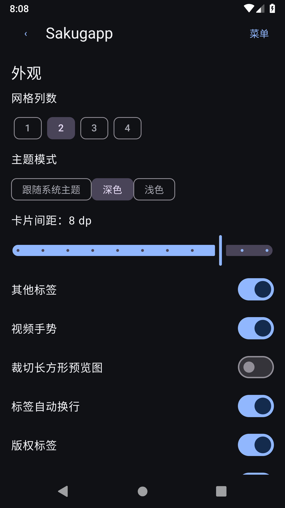

# Sakuga Mobile

[简体中文](#简体中文) · [English](#english) · [日本語](#日本語) · [Downloads](https://github.com/Milenal82/sakugapp/releases) · [Changelog](CHANGELOG.md)

## 简体中文

Sakuga Mobile（安装名称 Sakugapp）是 Sakugabooru 的非官方 Android 客户端，使用 Kotlin、Jetpack Compose 和 Media3。支持 Android 8.0 及以上，与 Sakugabooru、Sakuga Extended 无隶属关系。

### 功能

- 浏览真实帖子，连续加载、下拉刷新、返回保留位置。手机可选 1 / 2 / 3 / 4 / 6 列，平板另有 8 / 12 列。
- 原始标签搜索、组合条件、标签联想、搜索历史和查询备忘录。平均色工具分析已显示的缩略图，不是网站的颜色相似搜索。
- 原生详情、分类标签、Score、来源和评论；上一帖、下一帖、下载、原帖、收藏集中在同一操作栏。
- 全屏旋转、倍速、音量、A–B 循环、双指缩放、双击暂停、左右切帖。高级控制可折叠；支持实际解码索引的逐帧分析及帧号。
- 本地多收藏夹、封面与排序、JSON 备份；独立的标签收藏和本地备注。浏览历史可关闭、删除或清空。
- 深浅色主题、75%–125% 应用字号、0–12 dp 预览标签额外行距，八种界面语言；账户、Vote、评论和 Blog / Forum 入口。网站内容与原始标签保持原文，官网语言仅使用英语或日语。

### 下载与备份

正式 APK 在 [GitHub Releases](https://github.com/Milenal82/sakugapp/releases)，开发测试包在 [Actions](https://github.com/Milenal82/sakugapp/actions)。本次正式版本为 **1.2.0 / code 13**。

同包名 `com.sakugapp`、同正式证书签名的版本可覆盖安装。升级前建议导出收藏。Debug 与正式签名不同：切换前先备份，再卸载旧包、安装并导入；卸载会删除其他本地数据。

在收藏页使用“导入收藏记录 / 导出收藏记录”。备份包含收藏夹、顺序、封面、多收藏关系、标签收藏及独立备注；不包含媒体、账户凭据、设置或任何浏览历史。新格式带 `format` 与 `schemaVersion`，兼容旧版 v1 / v2 JSON，导入前展示数量及冲突选项，默认合并并保留本地备注。参见[备份格式与限制](docs/backup-format.md)。

### 构建与说明

需要 JDK 17、Android SDK 35 / Build Tools 35.0.0；使用仓库内 Gradle 8.13 Wrapper、AGP 8.9.2、Kotlin 2.1.20。最低 API 26，目标 API 35。

```sh
python3 scripts/check-localization.py
./gradlew testDebugUnitTest lintDebug assembleDebug
```

APK：`app/build/outputs/apk/debug/app-debug.apk`。正式签名配置见[签名说明](docs/release-signing.md)，不提供私钥。未配置正式签名的 Release 构建会失败。

逐帧分析需要 Android 9 以上及兼容解码器，单文件最多 200 MiB、最大 3840×2160；A–B 循环存在解码延迟。离线下载最多 20 个/批、200 MiB/文件、合计 1 GiB。浏览历史最多 500 条或 8 MiB，先移除最早记录。新译文经过资源与格式检查，未作母语审校；设备、网站访问和账户行为的验证范围见[测试记录](docs/test-report.md)。

## English

Sakuga Mobile (installed as Sakugapp) is an unofficial Android client for Sakugabooru, built with Kotlin, Jetpack Compose, and Media3. Requires Android 8.0 or later. It is not affiliated with Sakugabooru or Sakuga Extended.

### Features

- Real posts with continuous loading, pull to refresh, and restored scroll position. Phones support 1 / 2 / 3 / 4 / 6 columns; tablets also offer 8 / 12.
- Original tag queries, combined filters, tag suggestions, search history, and a query reference. The average-color tool analyzes displayed thumbnails; it does not perform server-side color similarity search.
- Native details with classified tags, Score, source, and comments. Previous, next, download, original post, and favorites share one toolbar.
- Fullscreen rotation, speed and volume controls, A–B loops, pinch zoom, double-tap pause, and swiping between posts. Collapsible advanced controls include decoded-index frame stepping and frame numbers.
- Local folders with covers, ordering, and JSON backup; separate tag favorites and local notes. Browsing history can be disabled, deleted individually, or cleared.
- Light and dark themes, 75%–125% app text size, 0–12 dp extra preview tag-row spacing, eight UI languages, account / Vote / comment features, and Blog / Forum links. Website content and tags stay in their original language; website locale uses English or Japanese only.

### Download and backup

Find signed releases in [GitHub Releases](https://github.com/Milenal82/sakugapp/releases) and development artifacts in [Actions](https://github.com/Milenal82/sakugapp/actions). The release version is **1.2.0 / code 13**.

Updates using the same package (`com.sakugapp`) and official certificate can be installed over the existing app. Export favorites first. Debug and official signatures differ: back up, uninstall, install the other build, and import. Uninstalling removes other local data.

Use the import / export entries on the favorites page. Backups include folders, ordering, covers, multiple folder memberships, tag favorites, and standalone notes. They exclude media, credentials, settings, and all browsing history. The format has explicit `format` and `schemaVersion` fields and accepts legacy v1 / v2 JSON. Imports preview counts and conflict options, merge by default, and retain existing notes by default. See the [backup format and limits](docs/backup-format.md).

### Build and limitations

Use JDK 17, Android SDK 35 / Build Tools 35.0.0, and the included Gradle 8.13 Wrapper. The project uses AGP 8.9.2 and Kotlin 2.1.20, with min API 26 and target API 35.

```sh
python3 scripts/check-localization.py
./gradlew testDebugUnitTest lintDebug assembleDebug
```

APK: `app/build/outputs/apk/debug/app-debug.apk`. See the [signing guide](docs/release-signing.md) for Release configuration. Private signing keys are not distributed, and Release builds fail when signing is missing.

Frame analysis requires Android 9 or later and a compatible decoder; the limit is 200 MiB per file and 3840×2160 frames. A–B loops are subject to decoding latency. Offline downloads allow 20 items per batch, 200 MiB per file, and 1 GiB total. Local history retains up to 500 entries or 8 MiB, removing oldest entries first. New translations have resource and format checks but no native-speaker review. See the [test report](docs/test-report.md) for device, website, and account verification limits.

## 日本語

Sakuga Mobile（インストール名 Sakugapp）は Sakugabooru の非公式 Android クライアントです。Kotlin、Jetpack Compose、Media3 を使用し、Android 8.0 以降に対応しています。Sakugabooru および Sakuga Extended とは提携していません。

### 機能

- 実際の投稿の連続読み込み、引っ張って更新、戻った際のスクロール位置の復元。スマートフォンは 1 / 2 / 3 / 4 / 6 列、タブレットはさらに 8 / 12 列に対応。
- 元のタグ名による検索、複合条件、タグ候補、検索履歴、検索構文の早見表。平均色ツールは表示中のサムネイルを分析するもので、サイトの色類似検索ではありません。
- 分類別タグ、Score、出典、コメントを表示するネイティブ詳細画面。前後の投稿、ダウンロード、元投稿、お気に入りを同じ操作バーに配置。
- 全画面回転、速度と音量、A–B リピート、ピンチズーム、ダブルタップで一時停止、左右の投稿切り替え。詳細操作は折りたたみ可能で、実際のデコードインデックスによるコマ送りとフレーム番号に対応。
- カバーと並び順を設定できるローカルフォルダ、JSON バックアップ、独立したタグのお気に入りとメモ。閲覧履歴の記録停止、個別削除、全消去。
- ライト / ダークテーマ、75%–125% の文字サイズ、プレビュータグの追加行間 0–12 dp、8 言語の UI、アカウント / Vote / コメント機能、Blog / Forum へのリンク。サイト本文とタグは原文のまま、サイトの言語指定は英語または日本語のみ。

### ダウンロードとバックアップ

正式署名 APK は [GitHub Releases](https://github.com/Milenal82/sakugapp/releases)、開発用 APK は [Actions](https://github.com/Milenal82/sakugapp/actions) から取得できます。今回の正式版は **1.2.0 / code 13** です。

パッケージ名 `com.sakugapp` と正式署名が同じ場合は上書きインストールできます。先にお気に入りをエクスポートしてください。Debug 版と正式版の署名は異なるため、切り替え時はバックアップ後にアンインストールし、別の版をインストールして取り込みます。アンインストールで他のローカルデータは消去されます。

お気に入り画面のインポート / エクスポートを使用します。フォルダ、順序、カバー、複数フォルダへの所属、タグのお気に入り、単独のメモを保存します。メディア、認証情報、設定、閲覧履歴は含みません。`format` と `schemaVersion` を持つ形式で、旧 v1 / v2 JSON にも対応。取り込み前に件数と競合時の選択肢を表示し、既定では既存データに統合してローカルのメモを保持します。[形式と制限](docs/backup-format.md)を参照してください。

### ビルドと制限

JDK 17、Android SDK 35 / Build Tools 35.0.0、同梱の Gradle 8.13 Wrapper を使用します。AGP 8.9.2、Kotlin 2.1.20、min API 26、target API 35 です。

```sh
python3 scripts/check-localization.py
./gradlew testDebugUnitTest lintDebug assembleDebug
```

APK：`app/build/outputs/apk/debug/app-debug.apk`。正式署名の設定は[署名ガイド](docs/release-signing.md)を参照してください。秘密鍵は配布せず、署名設定がなければ Release ビルドは失敗します。

フレーム解析には Android 9 以降と対応デコーダーが必要です。上限は 1 ファイル 200 MiB、3840×2160。A–B リピートにはデコード遅延があります。オフライン保存は 1 回 20 件、1 ファイル 200 MiB、合計 1 GiB まで。閲覧履歴は最大 500 件または 8 MiB で、古いものから削除します。新しい訳文はリソースと書式を検査済みですが、母語話者による確認は未実施です。端末・サイト・アカウント操作の検証範囲は[テスト記録](docs/test-report.md)を参照してください。

## Screenshots / 截图 / スクリーンショット

Actual Android emulator captures. These earlier captures do not show every change in the current development version; [capture details](docs/screenshots/README.md).

<p>
  
  
</p>

## License / 许可证 / ライセンス

[GPL-3.0-only](LICENSE). Corresponding source ZIPs accompany build artifacts and releases. Media remains the property of its rights holders. [Third-party notices](docs/third-party-notices.md) · [Data source](docs/data-source.md) · [Sakuga Extended feature review](docs/feature-matrix.md).
