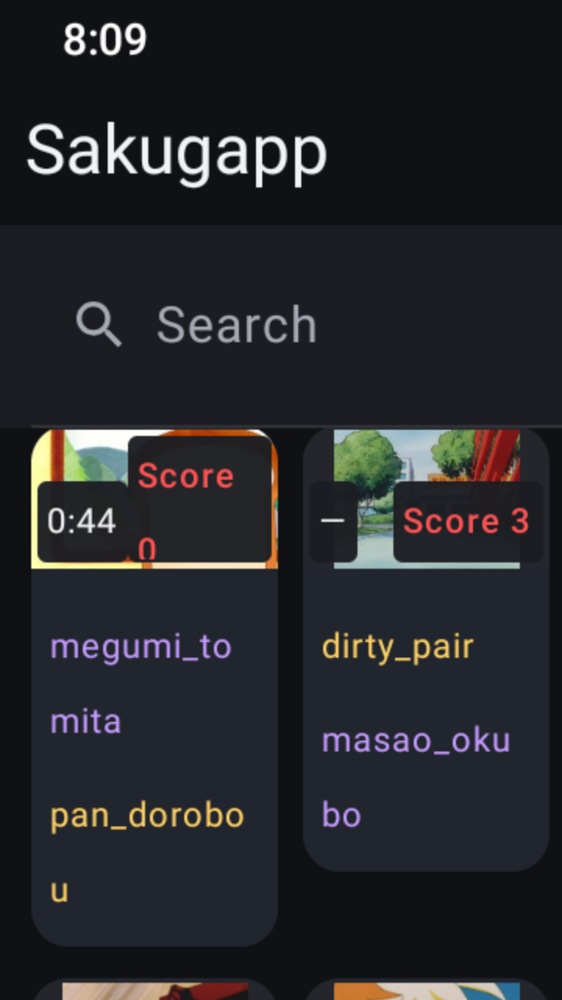
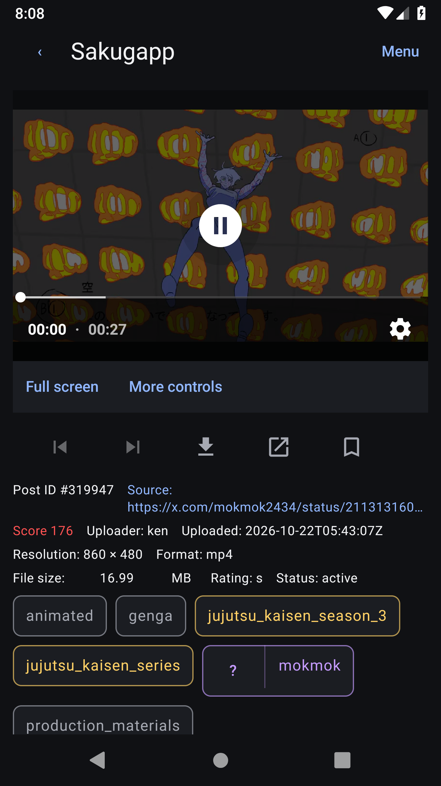
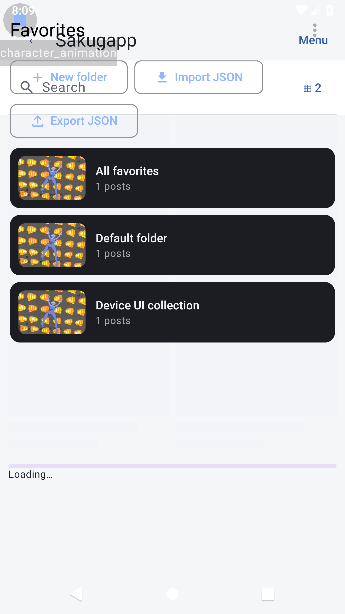

# Sakuga Mobile

Sakuga Mobile（安装名称 Sakugapp）是用于浏览 [Sakugabooru](https://www.sakugabooru.com/post) 的非官方 Android 客户端，使用 Kotlin、Jetpack Compose 和 Media3 构建原生界面。与 Sakugabooru 及 Sakuga Extended 无隶属关系，媒体和标签来自原网站。

支持 Android 8.0 及以上。界面提供简体中文、繁体中文、英语和日语；官网页面使用其支持的英语或日语。

## 主要功能

- 浏览与搜索：Post 连续加载、按 ID 去重、返回保留位置；向下滚动隐藏搜索区域，按需展开输入、组合条件和历史。支持原站标签语法、AND / OR / 排除、排序和 Score 快捷条件，标签联想与最多 50 条搜索历史。平均色工具计算可见缩略图的均色和 HEX，并非服务端颜色相似搜索。
- 帖子与布局：手机提供 1、2、3、4 列，平板另有 8、12 列。长方形缩略图保留比例，显示已获取的时长和真实 Score；版权标签为黄色，动画师标签为紫色。详情页的上一帖、下一帖、下载、原帖、收藏五个图标同排；Post ID、来源、Score 等元数据紧凑换行，保留分类标签和评论。
- 播放器：播放、拖动、静音、音量、0.1×–3× 倍速、全屏旋转、A–B 循环；双指缩放、双击暂停、左右切换当前列表中的帖子。高级控制可折叠，提供画面调整、镜像和截图分享。严格帧分析按实际解码索引步进并显示帧号，不用固定毫秒跳转代替逐帧。
- 收藏夹：本地多收藏夹、详情页快速收藏和取消收藏、封面与排序、批量管理、JSON 导入导出。首页只显示收藏夹，进入后使用相同的 Post 网格；可下载选定媒体供离线浏览。
- 外观：系统 / 深色 / 浅色主题，统一的 Post 浮块、圆角、按钮和展开动画。搜索与收藏管理默认收起次要操作，减少常驻控件。

账户登录、Vote、评论和 Blog / Forum 入口沿用已有实现。需要账户的操作以官网响应为准；本次发布没有自动执行真实账户的投票或评论写入。

## 截图

以下为实际 Android 模拟器截图；来源及隔离测试说明见 [截图记录](docs/screenshots/README.md)。

<p>
  
  
  
</p>

[平板 12 列](docs/screenshots/tablet-12-columns.png) · [收藏夹内页](docs/screenshots/compact-favorites-folder.png) · [播放器控制](docs/screenshots/professional-controls.png) · [简体中文设置](docs/screenshots/compact-settings-zh-cn.png)

## 下载与安装

从 [GitHub Releases](https://github.com/Milenal82/sakugapp/releases) 下载正式签名 APK；v1.1.0 对应 [APK](https://github.com/Milenal82/sakugapp/releases/download/v1.1.0/Sakugapp-v1.1.0-release.apk)、[完整源码](https://github.com/Milenal82/sakugapp/releases/download/v1.1.0/Sakugapp-v1.1.0-source.zip) 和 [SHA-256 校验文件](https://github.com/Milenal82/sakugapp/releases/download/v1.1.0/SHA256SUMS.txt)。允许下载所用浏览器安装未知来源应用后，打开 APK 安装。

包名保持 `com.sakugapp`。v1.1.0 使用 versionCode 10，高于 v1.0.0 及此前开发候选版。相同正式证书签名的版本直接覆盖安装，不要卸载；建议先导出收藏 JSON。收藏库、设置键和搜索历史沿用，数据库升级不清空收藏数据。

Debug 版与正式版证书不同，不能相互覆盖。切换前导出收藏 JSON，再卸载 Debug、安装正式版并导入。JSON 不包含账号、设置、搜索历史或下载的媒体，卸载会清除这些本地数据。

## 构建

需要 JDK 17、Android SDK 35 / Build Tools 35.0.0。仓库包含 Gradle 8.13 Wrapper，使用 AGP 8.9.2、Kotlin 2.1.20 和 Compose BOM 2025.04.01；最低 API 26，目标 API 35。

```sh
python3 scripts/check-localization.py
python3 -m unittest discover -s scripts/tests -v
./gradlew testDebugUnitTest lintDebug assembleDebug
```

Debug APK：`app/build/outputs/apk/debug/app-debug.apk`。连接支持的设备后，可运行 `./scripts/run-device-checks.sh` 执行设备测试并导出截图。

正式签名通过受保护的 GitHub Actions Secrets 完成，配置见 [签名说明](docs/release-signing.md)。已配置签名环境时运行：

```sh
./gradlew testReleaseUnitTest lintRelease assembleRelease
```

Release APK：`app/build/outputs/apk/release/app-release.apk`。缺少签名配置时正式构建会失败；`-PreleaseUnsignedCheck=true` 仅用于不可发布的未签名预检。发布构建先上传草稿，验证后再公开，既有 Release 不被覆盖。

## 限制与验证

A–B 循环按时间戳执行，存在播放器与解码延迟。严格帧分析需 Android 9（API 28）以上、支持索引解码的设备和格式，单文件最多 200 MiB、画面不超过 3840×2160；无法可靠对应当前播放时间时从第 1 帧开始，并提示限制。未知时长显示“—”。

离线批量下载最多 20 个/批、200 MiB/文件、1 GiB 总额，下载期间需保持页面打开。站点访问失败显示错误或空状态，不以虚构帖子填充。真机、其他 Android 版本和解码器的表现仍需测试。

本版构建、自动化测试与升级验证见 [v1.1.0 发布检查](docs/release-1.1.0.md)，接口与扩展调查见 [数据来源](docs/data-source.md) 和 [功能对照](docs/feature-matrix.md)。

## 许可证

项目采用 [GPL-3.0-only](LICENSE)。每个正式版本同时提供对应提交的完整源码 ZIP；APK 内含开源许可证和第三方声明。参考项目为 [Sakuga Extended](https://github.com/ftLoic/Sakuga-Extended)，未复制其网页脚本、样式或图片；依赖声明见 [THIRD_PARTY_NOTICES.md](docs/third-party-notices.md)。
